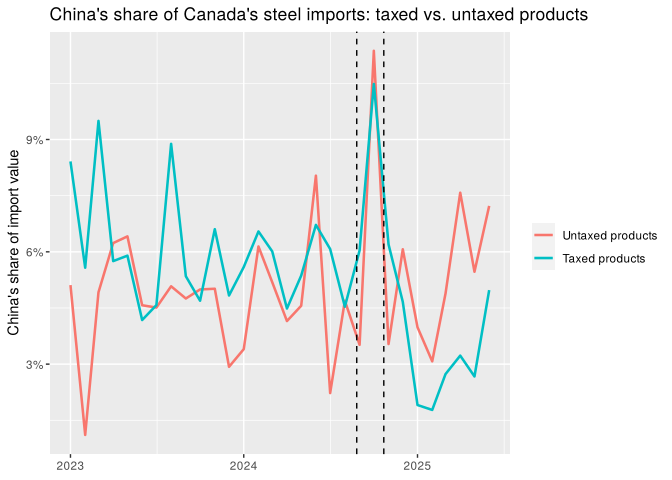

# Did Canada's 2024 Tariff on Chinese Steel Change Where Canada Buys Its Steel?

In October 2024, Canada added a 25% tax on steel and aluminum products from China. This
project uses Statistics Canada's monthly import records to ask whether China's share of
Canada's steel imports fell, and whether the tax was the reason, rather than seasons,
price changes, long-term trends or the 2025 trade dispute between the United States and
Canada.

- **One-page summary:** [summary.pdf](summary.pdf)
- **Full report:** [analysis.md](analysis.md) (readable on GitHub) or [analysis.pdf](analysis.pdf)



*China's share of Canada's steel imports, for products on the surtax list (taxed) and off it (untaxed). Dashed lines mark when the surtax was announced and when it took effect. Before the surtax the two groups followed similar paths; afterwards, China's share of taxed products fell further.*

## Main findings

**China's share of Canada's steel imports fell after the surtax.** It dropped from about 6%
before the surtax to under 4% in the four months after it took effect. The drop also shows
up when imports are measured by weight rather than value. The decline remains when comparing the same winter months one year apart, making a purely seasonal explanation less likely. Imports from China themselves fell by about 39% compared with the
same winter a year earlier.

**The drop was concentrated in the steel products the surtax targeted.** Comparing
products on and off the surtax list, China's share fell by about 2 percentage points more
for listed products, roughly a third of its earlier share. Before the surtax, the two
groups of products followed similar trends.

**The evidence is suggestive, not conclusive.** Only four months separate the surtax from
the 2025 US–Canada tariff dispute, so the cleanest estimate rests on very little data.
Depending on choices in the calculation, it falls just on one side or the other of the
usual threshold for statistical significance, and in a comparison that keeps the 167
products separate its likely range includes zero. If a slow drift in the gap between the two
groups before the surtax is assumed to have continued, most of the estimated effect
disappears. The main estimate is consistent with a surtax effect, but sensitive to modelling
choices.

**Japan is the most likely gainer.** Applying the same listed-versus-unlisted comparison
to every supplier, Japan's share of listed products rose by about 1.6 percentage points
more than its share of unlisted products. This holds up after adjusting for testing seven
suppliers, but not once Japan's earlier growth is also allowed for, so it is suggestive
rather than conclusive. South Korea's estimated gain is imprecise, and for the United States and
other countries the data are too noisy to tell. A lower Chinese share also does not by itself show that the policy
benefited Canada overall.

## What this means for decision-makers

- **Steel buyers and procurement teams.** A tariff on one supplier appears to move purchases
  to other suppliers rather than stop them; here, Japan is the most likely replacement. When
  a tariff on one country is announced, the practical question is which other suppliers can
  take over that volume.
- **Policymakers.** Looking only at the targeted country's share overstates what a tariff
  achieves. Running the same comparison for every supplier shows where the lost share went,
  which is what is needed to judge whether a policy reduced reliance on imports or only
  changed where they come from. These data cannot show whether the surtax raised prices for
  Canadian buyers.
- **Anyone judging a change from early data.** Four months before a second shock was enough
  to see a pattern but not to confirm it. In that situation the useful answer is a range of
  estimates and a clear statement of what would change the conclusion, not a single number.
  The same applies to an early read on a new product, price change or campaign.

### Technical details

- Difference-in-differences, 130 listed vs. 37 unlisted six-digit products, month fixed
  effects. Main window (to Feb 2025): −1.9 pp; p = 0.086 (OLS), p = 0.034 (Newey-West,
  3 lags). Window to Jan 2025: −1.6 pp (Newey-West p = 0.094). Window to Jun 2025, which
  overlaps the tariff dispute: −3.1 pp (Newey-West p = 0.001).
- Product-level panel (167 products, product and month fixed effects, weighted by pre-surtax
  imports, standard errors clustered by product): −1.6 pp in the main window (p = 0.16);
  −2.6 pp to Jun 2025 (p = 0.004).
- Pre-surtax check: event study on the panel, joint test that all 19 pre-surtax months are
  equal, p = 0.29. Adding a linear trend to the gap, fitted over all months used, shrinks the
  main estimate to −0.5 pp (p = 0.64).
- Diversion (same comparison for each supplier's share, main window): Japan +1.6 pp
  (p = 0.003, Holm-adjusted for seven suppliers p = 0.019; with its own trend +2.1 pp,
  Holm-adjusted p = 0.073); South Korea +1.5 pp (p = 0.11); United States and other
  countries noisy (p = 0.34 and 0.51).

## Related research

The results are consistent with studies finding that tariffs on one supplier shift
purchases toward other countries (Flaaen, Hortaçsu and Tintelnot, 2020; Fajgelbaum and
others, 2024), that targeted exporters redirect sales elsewhere (Bown and Crowley, 2007),
and that the cost of tariffs falls largely on buyers in the country imposing them (Amiti,
Redding and Weinstein, 2019; Fajgelbaum and others, 2020). Full references are at the end
of the report.

## Methods

- Import shares by country, in value and in tonnes, and the actual amounts imported
- Seasonality check: the same winter months one year apart
- Difference-in-differences: 130 six-digit products on the Department of Finance's surtax
  list vs. 37 products not on it, with month fixed effects and Newey-West standard errors,
  which allow for correlation between months
- Product-level panel with product and month fixed effects and standard errors clustered by
  product, plus a month-by-month event study to check the months before the surtax
- The same comparison applied to every supplier's share, to trace where China's lost share
  went

## Files

| File | Contents |
|---|---|
| `analysis.Rmd` | Full analysis (R Markdown) |
| `analysis.md`, `analysis_files/` | Full report rendered for GitHub, with figures |
| `analysis.pdf` | Full report as PDF (code hidden) |
| `summary.Rmd`, `summary.pdf` | One-page summary |
| `scripts/render.R` | Rebuilds the reports in one step |
| `renv.lock`, `renv/`, `.Rprofile` | Records the exact R package versions (renv) |
| `data/total.csv` | Canada's chapter 72 imports from the world |
| `data/` (`china.csv`, `us.csv`, `korean_south.csv`, `japan.csv`, `vietnam.csv`, `taiwan.csv`) | Canada's chapter 72 imports from each country |

## How to run

1. Install R (4.4 recommended, matching `renv.lock`) and RStudio.
2. Download or clone this repository, keeping the folder structure (the data files are in `data/`),
   and open the repository folder as an RStudio project.
3. Install the exact package versions used for the analysis, recorded in `renv.lock`:
   ```r
   install.packages("renv")
   renv::restore()
   tinytex::install_tinytex()   # only needed for PDF output
   ```
4. From the repository folder, run `Rscript scripts/render.R` to rebuild the Markdown report
   and both PDFs (`Rscript scripts/render.R --markdown-only` skips the PDFs). Alternatively,
   open `analysis.Rmd` or `summary.Rmd` in RStudio and click **Knit**.

## Data

Statistics Canada, Canadian International Merchandise Trade (CIMT) Web Application,
imports, HS chapter 72 (iron and steel) at the 6-digit level, monthly, January 2023 to
August 2026, values in Canadian dollars. Each country was downloaded separately, plus
"The world" for totals. The data are used under the
[Statistics Canada Open Licence](https://www.statcan.gc.ca/en/reference/licence).

- CIMT: https://www150.statcan.gc.ca/n1/pub/71-607-x/71-607-x2021004-eng.htm
- Surtax list: [Department of Finance Canada (2024), Final list of steel and aluminum products from China that will be subject to a 25 per cent surtax](https://www.canada.ca/en/department-finance/news/2024/10/final-list-of-steel-and-aluminum-products-from-china-that-will-be-subject-to-a-25-per-cent-surtax.html)

## Author

Xiang Zheng, University of Toronto (Economics major; Statistics and Mathematics minors)
